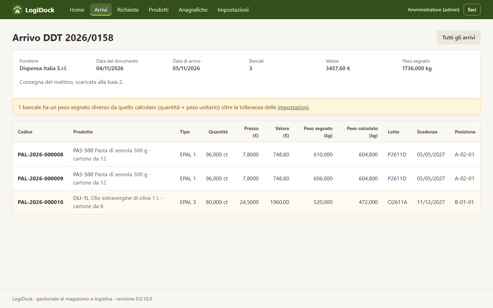

#  LogiDock



Gestionale web per una piccola azienda di logistica locale: anagrafica prodotti, bancali in ingresso,
tracciabilità dei movimenti, pianificazione dei viaggi, bolle e DDT, utenti e ruoli.

È anche un progetto personale per il portfolio: tutto è costruito da zero (niente framework full-stack)
per mostrare come funziona ogni pezzo.

Il codice è **source available** con doppia licenza: gratuito per gli usi non commerciali
([PolyForm Noncommercial License 1.0.0](LICENSE)), a pagamento con una
[licenza commerciale separata](COMMERCIAL-LICENSE.md) per gli usi commerciali o professionali.
Dettagli in [Licenza](#licenza).

> **Stato:** Fasi 1-6 e 8-10 completate (scheletro, database, autenticazione, prodotti, ambiente e deploy,
> test, anagrafiche e impostazioni, arrivi di merce, richieste dei clienti). Le altre funzionalità arrivano una alla volta, vedi [Roadmap](#roadmap).

## Stack

| Componente | Scelta |
|---|---|
| Linguaggio | PHP 8.3, senza framework |
| Database | MySQL 8 con PDO e prepared statement (niente ORM) |
| Frontend | HTML, CSS e JavaScript vanilla, template PHP lato server |
| Web server | Nginx + PHP-FPM su Ubuntu Server 24.04 LTS |
| Sviluppo | Docker Compose (solo dev) oppure PHP e MySQL installati in locale |

Pacchetti Composer: `vlucas/phpdotenv` (lettura di `.env`) e `phpunit/phpunit` (test, solo sviluppo).

## Architettura

```
Browser
   │  HTTP
   ▼
Nginx ──► public/index.php (front controller)
              │
              ▼
          Application ──► Router ──► [Middleware] ──► Controller
                                                          │
                                                          ▼
                                                       Service     (logica di business, validazione, transazioni)
                                                          │
                                                          ▼
                                                     Repository    (solo SQL, via PDO)
                                                          │
                                                          ▼
                                                        MySQL
              Controller ──► View (template PHP + layout) ──► Response ──► Browser
```

Regole dei livelli: il controller non contiene regole di business, il service non contiene SQL,
il repository non contiene regole. Gli errori non gestiti arrivano a un gestore centrale
(`ErrorHandler`) che scrive sul log e mostra una pagina generica.

### Struttura delle cartelle

```
public/        unico document root esposto da Nginx (index.php, asset)
src/Core/      router, request/response, container, view, logger, gestione errori, validatore
src/Controller controller (sottili)
src/Service    logica di business
src/Repository accesso al database
src/Model      entità e DTO
bin/           script da riga di comando (migrate.php, seed.php, create-user.php)
config/        app.php (da .env) e routes.php (tutte le rotte)
templates/     template PHP e layout
database/      migrazioni SQL e seed
deploy/        configurazione di produzione (Nginx, PHP-FPM, backup)
docker/        file per l'ambiente di sviluppo con Docker
tests/         test PHPUnit
storage/logs/  log applicativo (non versionato)
```

## Avvio in locale

Requisiti: PHP 8.3 (con `pdo_mysql`, `mbstring`, `intl`), Composer, MySQL 8.

```powershell
composer install
Copy-Item .env.example .env      # poi modifica i valori in .env
php -S localhost:8000 -t public
```

Apri <http://localhost:8000>. Con `APP_DEBUG=true` le pagine di errore mostrano i dettagli;
in produzione deve essere `false`.

### Database

Serve un MySQL 8 con un database `logidock` e un utente con tutti i permessi su di esso
(credenziali in `.env`). Poi:

```powershell
php bin/migrate.php            # applica le migrazioni mancanti
php bin/migrate.php --status   # stato di ogni migrazione (applied / pending / changed)
php bin/seed.php               # dati di esempio, solo sviluppo (rifiutato con APP_ENV=production)
```

Prima del seed imposta `SEED_ADMIN_PASSWORD` e `SEED_OPERATOR_PASSWORD` in `.env`:
gli utenti di esempio sono `admin@logidock.test` e `operatore@logidock.test`.

Le migrazioni sono file SQL numerati in `database/migrations`, ripetibili (`IF NOT EXISTS`).
Una migrazione già applicata **non si modifica**: `migrate.php` se ne accorge dal checksum e si
ferma. Una correzione si fa con una nuova migrazione.

> **MySQL e i trigger:** MySQL 8 ha il binary log attivo di default e in quel caso un utente senza
> `SUPER` non può creare trigger (errore 1419). La migrazione `0009` crea i trigger che rendono
> `pallet_movements` append-only, quindi serve `log_bin_trust_function_creators=1` nella
> configurazione di MySQL (oppure eseguire le migrazioni con un utente privilegiato).

### Schema

```
users ─┬──< pallets >── products          pallets: stato corrente di ogni bancale
       │      │  └───── suppliers         pallet_movements: storico append-only (solo INSERT)
       │      └──────── warehouse_locations
       ├──< pallet_movements >── pallets, warehouse_locations (da/a), trips
       ├──< trips >── vehicles
       │      ├──< trip_items >── pallets
       │      └──< transport_documents    (bolla / DDT, numerati con number_sequences)
```

Dalla Fase 10 `orders` e `order_lines` (richieste dei clienti e loro righe). Dalla Fase 9 `supplier_documents` (documenti dei fornitori) e, su `pallets`, tipo di bancale, documento,
prezzo d'acquisto e peso segnato. Dalla Fase 8 si aggiungono: `settings` (impostazioni), `pallet_types` e `trailer_types` (misure), `rounds` e
`customers` (giri e clienti), `carriers` (trasportatori). `vehicles` punta a un tipo di rimorchio e a un
trasportatore, `warehouse_locations` ha una capacità facoltativa.

### Autenticazione

Utenti di esempio (dal seed): `admin@logidock.test` e `operatore@logidock.test`; le password sono
quelle di `SEED_ADMIN_PASSWORD` e `SEED_OPERATOR_PASSWORD` in `.env`.

- **Password:** `password_hash` / `password_verify` (bcrypt oggi, con rehash automatico se l'algoritmo
  predefinito di PHP cambia). Se l'email non esiste si fa comunque un `password_verify` su un hash finto,
  così il tempo di risposta non rivela quali email sono registrate; il messaggio di errore è sempre lo stesso.
- **Sessione:** cookie `HttpOnly` e `SameSite=Lax` (`Secure` se `APP_URL` è https), `use_strict_mode`,
  nuovo ID di sessione a ogni login, scadenza per inattività (`SESSION_LIFETIME_MINUTES`).
  Nella sessione c'è solo l'id utente: ruolo e stato attivo si rileggono dal database a ogni richiesta,
  quindi disattivare un utente ha effetto subito.
- **CSRF:** ogni POST richiede il token (campo `_csrf` o header `X-CSRF-Token`), altrimenti 419.
- **Ruoli:** `AuthMiddleware` (qualunque utente collegato) e `AdminMiddleware` (solo admin, gli altri ricevono 403).
  I middleware si assegnano alle rotte in `config/routes.php`, anche a gruppi con `$router->group()`.
- **Non c'è** un limite ai tentativi di login: l'app è raggiungibile solo dalla rete locale.
  I tentativi falliti finiscono nel log (mai la password).

### Anagrafica prodotti (esempio da replicare)

La prima funzionalità completa, scritta per essere il modello delle prossime. Attraversa tutti i livelli:

| Livello | File | Cosa fa |
|---|---|---|
| Rotte | `config/routes.php` | chi può fare cosa (qualunque utente consulta, solo l'admin modifica) |
| Controller | `src/Controller/ProductController.php` | legge la richiesta, chiama il service, sceglie la risposta (render, redirect, 404) |
| Service | `src/Service/ProductService.php` | validazione, normalizzazione, unicità del codice |
| Repository | `src/Repository/ProductRepository.php` | solo SQL con prepared statement |
| Modello | `src/Model/Product.php`, `ProductData.php` | dato letto dal database / dato validato da scrivere |
| Template | `templates/products/` | lista con ricerca, form condiviso da creazione e modifica |

| Rotta | Chi | Azione |
|---|---|---|
| `GET /products` | admin, operatore | lista, con ricerca `?q=` per codice o descrizione |
| `GET /products/create`, `POST /products` | admin | nuovo prodotto |
| `GET /products/{id}/edit`, `POST /products/{id}` | admin | modifica |
| `POST /products/{id}/deactivate`, `.../activate` | admin | disattiva / riattiva |

Scelte da sapere:
- **Non si cancella mai**: un prodotto ha bancali collegati, quindi si disattiva (e si può riattivare).
- **Validazione nel service**, che lancia `ValidationException` con un messaggio per campo. Il controller
  ripresenta il form con gli errori e i valori digitati (risposta 422).
- **Il peso è sempre una stringa**: `12,5` o `12.5` diventano `12.500` senza passare da float.
- **Codice univoco anche in concorrenza**: il service controlla prima, ma l'ultima parola è del vincolo
  UNIQUE del database; il repository traduce l'errore in `DuplicateEntryException`.
- **Pattern post/redirect/get** con messaggi flash dopo ogni scrittura, così il refresh non ripete l'azione.
- Nella lista non c'è paginazione (pochi prodotti): si aggiungerà se serve.

Per aggiungere una nuova funzionalità si copiano questi sei file cambiando nome ed entità.

### Anagrafiche (fornitori, clienti, giri, veicoli, rimorchi, trasportatori, posizioni, tipi di bancale)

Otto anagrafiche quasi identiche (lista con ricerca, nuovo, modifica, disattiva/riattiva), quindi non sono
copiate otto volte: hanno una **base comune** e ognuna aggiunge solo le sue regole.

| Pezzo | Dove | Cosa fa |
|---|---|---|
| Repository base | `src/Repository/MasterDataRepository.php` | ricerca, lettura, insert, update, attiva/disattiva. Le sottoclassi dicono solo tabella, colonne e dove cercare |
| Service base | `src/Service/MasterDataService.php` | crea/modifica/cerca/disattiva, traduce i duplicati in errore sul campo. Ogni service scrive solo `validate()` |
| Controller base | `src/Controller/MasterDataController.php` | il flusso della lista e dei form. Ogni controller dice rotta, nomi e campi |
| Validatore | `src/Core/Validator.php` | testo, e-mail, interi, decimali (stringhe, mai float), codici, scelte, riferimenti ad altre anagrafiche |
| Pezzi di pagina | `templates/partials/` | campo, menu a tendina, intestazione di lista, pulsanti di riga |

Nell'SQL della base entrano solo nomi di tabelle e colonne scritti nel codice delle sottoclassi; i valori
passano sempre da prepared statement.

| Anagrafica | Rotta | Regole particolari |
|---|---|---|
| Fornitori | `/suppliers` | **tutti i campi obbligatori** (ragione sociale, partita IVA / codice fiscale, indirizzo, e-mail valida, telefono); nel database restano facoltativi per i fornitori registrati prima della regola |
| Clienti | `/customers` | ogni cliente può avere un giro (solo giri attivi) |
| Giri | `/rounds` | nome unico |
| Veicoli | `/vehicles` | targa unica (maiuscola), tipo di rimorchio e trasportatore facoltativi |
| Tipi di rimorchio | `/trailer-types` | lunghezza, larghezza, altezza interna (mm) e portata; il pianale è un rettangolo |
| Trasportatori | `/carriers` | compenso fisso per viaggio; **solo admin**, anche la lista |
| Posizioni di magazzino | `/locations` | codice unico, capacità facoltativa (vuota = capacità predefinita) |
| Tipi di bancale | `/pallet-types` | codice unico; EPAL 3 (1200 × 1000 mm) ed EPAL 1 (1200 × 800 mm) già presenti |

In tutte le schede i **campi obbligatori hanno un asterisco rosso** accanto all'etichetta (nelle tabelle a righe di
arrivi e richieste, accanto al titolo della colonna). L'asterisco è solo visivo: ai lettori di schermo l'obbligo
arriva dall'attributo `required` del campo, che i partial `field` e `select` mettono insieme all'asterisco.

Come per i prodotti, tutti consultano e solo gli admin modificano. Un riferimento già assegnato (il giro di
un cliente) che viene disattivato resta sul record e non sparisce dal form, ma non si può assegnare a record nuovi.

### Arrivi di merce

Il lavoro di ogni giorno del magazzino: arriva un documento del fornitore con uno o più bancali. Lo
registra **qualunque utente collegato** (non solo l'admin) da `/inbound`.

Un arrivo è una testata (fornitore, numero del documento, data del documento, data di arrivo, note) più
una riga per ogni bancale: prodotto, tipo di bancale, quantità, prezzo d'acquisto unitario, **peso lordo
segnato dal fornitore**, lotto, scadenza e posizione. Il form aggiunge e toglie righe con un po' di
JavaScript (`public/assets/js/app.js`); senza JavaScript funziona lo stesso con le righe già mostrate.

| Pezzo | Dove | Cosa fa |
|---|---|---|
| Service | `src/Service/InboundService.php` | valida testata e righe, controlla la capacità, scrive tutto in una transazione |
| Repository | `SupplierDocumentRepository`, `PalletRepository`, `PalletMovementRepository`, `NumberSequenceRepository` | solo SQL |
| Controller e template | `InboundController`, `templates/inbound/` | lista, nuovo arrivo, dettaglio |

Cosa succede quando si registra un arrivo, **tutto in una sola transazione** (se qualcosa non va non resta niente a metà):

1. si salva il documento del fornitore (lo stesso fornitore non può avere due volte lo stesso numero con la stessa data);
2. per ogni riga si assegna il codice `PAL-AAAA-NNNNNN` (numeratore per anno, senza buchi né doppioni anche con due utenti insieme);
3. si salva il bancale (stato corrente) e **un movimento di ingresso** nello storico, che è append-only.

Regole da sapere:
- **Capacità:** una posizione non può superare la sua capacità (quella propria o, se vuota, quella delle impostazioni). Il conteggio è fatto nella stessa transazione; resta una piccola finestra se due persone riempiono la stessa posizione nello stesso istante: è un avviso pratico, non un vincolo come il codice univoco.
- **Peso:** il peso segnato dal fornitore si confronta con quello calcolato (quantità × peso unitario del prodotto). Se differisce oltre la tolleranza delle impostazioni (5% di partenza) il bancale è evidenziato. Il confronto lo fa MySQL in DECIMAL, senza float in PHP.
- **Date:** la data di arrivo non può essere nel futuro, il documento non può essere dopo l'arrivo, una scadenza non può precedere l'arrivo.
- **Prezzo:** è il prezzo d'acquisto **per unità di misura** del prodotto (valore del bancale = quantità × prezzo).
- **Un arrivo registrato non si modifica:** i movimenti sono uno storico. Una correzione si farà con un movimento di rettifica.

### Richieste dei clienti

Cosa chiede ogni cliente, da `/orders`. Le registra **qualunque utente collegato**, come gli arrivi.

Una richiesta ha un cliente (con il suo giro), la data della richiesta, la **consegna desiderata**, delle note e
una riga per prodotto: quantità (nell'unità di misura del prodotto) e **prezzo di vendita** per unità. Il prezzo
è una "fotografia" del momento: se cambia il listino, le richieste già fatte non cambiano.

| Pezzo | Dove | Cosa fa |
|---|---|---|
| Service | `src/Service/OrderService.php` | valida testata e righe, assegna il codice, scrive in transazione, blocca le modifiche se non è più aperta |
| Repository | `src/Repository/OrderRepository.php` | solo SQL: lista con totali, righe con giacenza, inserimento, sostituzione delle righe |
| Controller e template | `OrderController`, `templates/orders/` | lista con filtri, nuova, dettaglio, modifica, annullamento |

Regole da sapere:
- **Codice** `ORD-AAAA-NNNNNN`, progressivo per anno, con lo stesso numeratore dei bancali (tipo `order`).
- **Stati:** *aperta* (si modifica e si annulla), *pianificata* e *spedita* (li useranno pianificazione e consegne),
  *annullata*. Una richiesta **non si cancella mai**: fa parte dello storico.
- **Un prodotto una sola volta per richiesta:** se compare su due righe il form chiede di sommare le quantità.
- **Date:** la richiesta non può essere nel futuro, la consegna non può essere prima della richiesta.
- **Giacenza:** nel dettaglio, per ogni prodotto, si vede quanto ce n'è adesso in magazzino (bancali *in_stock*);
  se non basta la riga è evidenziata. È un'indicazione: cosa va davvero a ogni cliente lo deciderà la pianificazione.
- Un cliente o un prodotto disattivato dopo la richiesta resta su quella richiesta e non sparisce dal form di
  modifica, ma non si può usare in una richiesta nuova.
### Impostazioni

Pagina `/settings`, solo admin. I valori di business non sono scritti nel codice: si chiedono a
`SettingService`.

| Impostazione | Valore di partenza |
|---|---|
| Altezza massima di carico del bancale | 750 mm (ogni tipo di bancale può avere la sua) |
| Giorni dopo i quali un bancale fermo viene segnalato | 2 |
| Capacità predefinita di una posizione | 300 bancali |
| Tolleranza sul peso dei bancali (segnato dal fornitore contro calcolato) | 5 % |
| Ragione sociale, indirizzo, partita IVA e piè di pagina dei documenti | vuoti |

Le definizioni (limiti e valore di partenza) stanno in un solo elenco in `SettingService::definitions()`: nel
database finisce solo ciò che l'admin salva. Per aggiungere un'impostazione basta una riga in quell'elenco.

### Avvio con Docker (sviluppo)

`docker-compose.yml` avvia Nginx 1.24, PHP-FPM 8.3 e MySQL 8.0, le stesse versioni di Ubuntu 24.04.
Nel `.env` imposta una `DB_PASSWORD` (e `DB_HOST=db`, anche se il compose lo forza comunque), poi:

```powershell
docker compose up -d --build
docker compose run --rm php composer install
docker compose run --rm php php bin/migrate.php
docker compose run --rm php php bin/seed.php
```

Apri <http://localhost:8080>. MySQL è raggiungibile dal PC su `127.0.0.1:3307`.

> **Non testato:** quando sono stati scritti non c'era Docker a disposizione, quindi `docker-compose.yml`
> e i file in `docker/` non sono mai stati eseguiti. Se qualcosa non parte, il primo posto dove guardare
> sono i log (`docker compose logs`).

### Produzione e backup

`deploy/` contiene la configurazione di Nginx (accesso limitato alla subnet locale, `.env` e `.git`
bloccati, intestazioni di sicurezza), il pool PHP-FPM, `backup.sh` per cron, `deploy.sh` per gli
aggiornamenti e la guida passo passo **[deploy/README.md](deploy/README.md)** per installare tutto
su Ubuntu Server 24.04 da zero.

Punti di sicurezza da conoscere:
- L'applicazione in produzione usa un utente MySQL con **permessi minimi** (`grant-app-user.sh`): su
  `pallet_movements` può solo leggere e inserire, quindi lo storico resta intatto anche in caso di bug.
  Un altro utente, separato, applica le migrazioni.
- Il seed è disabilitato in produzione: il primo admin si crea con `php bin/create-user.php`.

## Test

I test usano PHPUnit e stanno in `tests/`:

| File | Tipo | Cosa verifica |
|---|---|---|
| `tests/Core/RouterTest.php` | unitario | rotte, parametri `{id}`, 404 e 405, ordine dei middleware, gruppi, middleware che blocca |
| `tests/Core/RequestTest.php` | unitario | normalizzazione di percorso e metodo, lettura dell'input |
| `tests/Core/MigrationRunnerTest.php` | unitario | lo spezzatore delle istruzioni SQL delle migrazioni |
| `tests/Core/ValidatorTest.php` | unitario | ogni controllo del validatore, con valori limite e input ostili (apici, tag, array) |
| `tests/Service/ProductServiceTest.php` | integrazione | validazione, normalizzazione, codici duplicati, attiva/disattiva, ricerca (con il vero repository) |
| `tests/Service/MasterDataServicesTest.php` | integrazione | regole comuni delle anagrafiche e quelle di ognuna (giri dei clienti, targhe, capacità, EPAL) |
| `tests/Service/SettingServiceTest.php` | integrazione | valori di partenza, salvataggio, tutto-o-niente, limiti |
| `tests/Service/InboundServiceTest.php` | integrazione | arrivo completo (documento, bancali, movimenti), codici consecutivi, errori sulla riga giusta, capacità, peso, documento duplicato, tutto-o-niente |
| `tests/Service/OrderServiceTest.php` | integrazione | richiesta completa, codici consecutivi, date, prodotto ripetuto, modifica che sostituisce le righe, annullamento, stati bloccati, giacenza |
| `tests/Core/DatabaseTransactionTest.php` | integrazione | commit, rollback e savepoint quando una transazione è già aperta |
| `tests/Core/ApplicationConfigTest.php` | unitario | le variabili d'ambiente vere vincono su `.env` |

I test del service parlano con MySQL, ma **solo con il database di test** (`logidock_test`):
`phpunit.xml` forza `DB_NAME=logidock_test` e `TestDatabase` si rifiuta di partire con un database
il cui nome non finisce in `_test`. Ogni test gira in una transazione che si annulla alla fine,
quindi il database resta pulito. Se MySQL non è raggiungibile quei test vengono saltati (e lo dicono).

Preparazione, una volta sola (serve un utente con permessi anche su `logidock_test`):

```powershell
# in MySQL: CREATE DATABASE logidock_test; GRANT ALL ON logidock_test.* TO 'logidock'@'localhost';
$env:DB_NAME = 'logidock_test'; php bin/migrate.php; Remove-Item Env:DB_NAME
composer test
```

Per lanciare un solo test: `php vendor/bin/phpunit --filter testDeactivateAndActivate`.

Il database di test non va riempito col seed. Quando il codice cambia lo schema, rilancia la migrazione
con la stessa riga di sopra.

## Roadmap

- [x] **Fase 0:** piano, schema del database e decisioni architetturali
- [x] **Fase 1:** scheletro (router, configurazione, gestione errori, layout)
- [x] **Fase 2:** migrazioni SQL, script di migrazione, seed
- [x] **Fase 3:** autenticazione, sessioni sicure, CSRF, ruoli
- [x] **Fase 4:** anagrafica prodotti (funzionalità verticale di esempio)
- [x] **Fase 5:** Docker Compose, configurazione di produzione, backup
- [x] **Fase 6:** test PHPUnit e documentazione finale

### Prossime fasi (dalle richieste dell'azienda)

L'azienda vuole registrare le richieste dei clienti e i bancali che arrivano ogni giorno, far decidere
al programma cosa va su quale rimorchio e cosa resta in magazzino, avvisare quando qualcosa è fermo da
troppo tempo, e produrre tutti i documenti (carico per camion, consegna per cliente, compenso per i
camionisti). Serve anche lo storico di viaggi, forniture e pagamenti.

- [ ] **Fase 7:** modello dati v2. *Fatto per le anagrafiche* (impostazioni, clienti, giri, trasportatori, tipi di
  bancale e di rimorchio, capacità delle posizioni); mancano documenti del fornitore, richieste e tappe dei viaggi,
  che si aggiungono insieme alle fasi che li usano
- [x] **Fase 8:** anagrafiche (fornitori, clienti, giri, veicoli, trasportatori, rimorchi, posizioni, tipi di bancale) e impostazioni
- [x] **Fase 9:** arrivi giornalieri: documento del fornitore con date, bancali con prezzo e peso, posizione
- [x] **Fase 10:** richieste dei clienti
- [ ] **Fase 11:** giacenze e avviso per i bancali fermi da troppo tempo
- [ ] **Fase 12:** pianificazione dei viaggi (assegnazione automatica ai rimorchi, modifica manuale e ricalcolo)
- [ ] **Fase 13:** documenti in PDF (carico per camion, consegna per cliente con prezzi, compenso camionisti)
- [ ] **Fase 14:** storico viaggi, forniture per fornitore, pagamenti dei clienti, report
- [ ] **Fase 15:** qualità finale e deploy

## Versione

La versione sta nel file [`VERSION`](VERSION) e si vede nel piè di pagina dell'applicazione e del sito.
Il formato è `MAGGIORE.MINORE.FASE.COMMIT`, per esempio `0.0.10.0`:

| Numero | Significato |
|---|---|
| FASE (terzo) | la fase di sviluppo in corso, per ora legata alla roadmap |
| COMMIT (ultimo) | cresce di uno a ogni commit e riparte da 0 quando inizia una nuova fase |

```powershell
php bin/version.php            # mostra la versione
php bin/version.php bump       # prima di ogni commit: +1 all'ultimo numero
php bin/version.php phase 11   # all'inizio di una nuova fase: 0.0.11.0
```

Il comando aggiorna `VERSION` e il numero scritto nel sito vetrina; l'applicazione legge `VERSION` da sola.
Non è *semantic versioning* (che ha tre numeri), per questo la versione non sta in `composer.json`.

## Licenza

LogiDock è **source available** e ha una **doppia licenza**:

| Uso | Licenza | Costo |
|---|---|---|
| Non commerciale: usi personali (studio, ricerca, hobby...) e uso da parte di enti benefici, istituti di istruzione, enti pubblici di ricerca, organizzazioni per la sicurezza o la salute pubblica, organizzazioni per la tutela dell'ambiente e istituzioni governative | [PolyForm Noncommercial License 1.0.0](LICENSE) | gratuito |
| Commerciale o professionale, non consentito dalla licenza gratuita (per esempio un'azienda che lo usa per la propria attività) | accordo di licenza commerciale separato con il titolare dei diritti | a pagamento |

- [LICENSE](LICENSE) contiene il testo ufficiale della PolyForm Noncommercial License 1.0.0, in inglese e
  senza modifiche. È quello il testo che vale: questa tabella è solo un riassunto.
- [NOTICE](NOTICE) contiene l'avviso di copyright (`Required Notice:`) che, secondo la licenza, deve
  accompagnare ogni copia del software.
- [COMMERCIAL-LICENSE.md](COMMERCIAL-LICENSE.md) spiega quando serve la licenza commerciale e come
  chiederla. È una pagina informativa: **non concede da sola nessuna licenza**.

**Come richiedere una licenza commerciale:** scrivi a
**<riccardo.melis06@gmail.com>** indicando chi sei, come vuoi usare
LogiDock, quante installazioni o utenti prevedi e per quanto tempo. Prezzo e condizioni si concordano
nell'accordo scritto.

"Source available" e non "open source": il codice è pubblico e si può studiare, ma la licenza gratuita
esclude l'uso commerciale, e la definizione di open source non ammette limiti di questo tipo.

Da sapere:
- Le versioni pubblicate prima dell'aggiunta del file `LICENSE` non avevano una licenza esplicita: per
  quelle restano solo i diritti che i Termini di servizio di GitHub danno agli utenti sui repository
  pubblici (per esempio il fork su GitHub).
- Le librerie installate con Composer (MIT, BSD-3-Clause, Apache-2.0) e le immagini Docker di sviluppo
  hanno le loro licenze, che non cambiano. Non sono incluse in questo repository: Composer e Docker le
  scaricano a parte.
- Il software non contiene sistemi di attivazione, pagamento o blocco.
